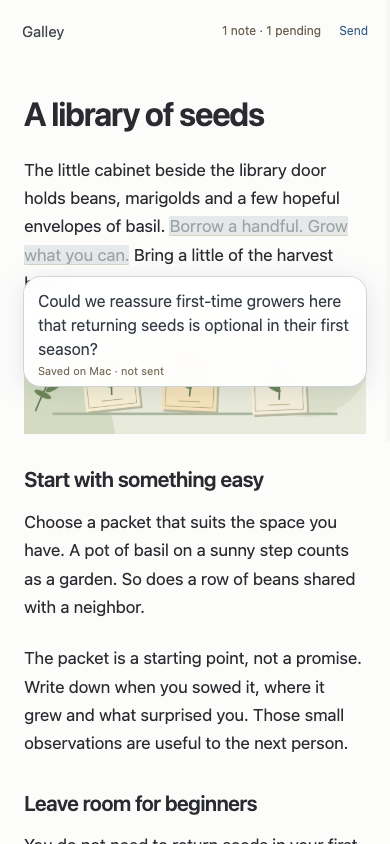
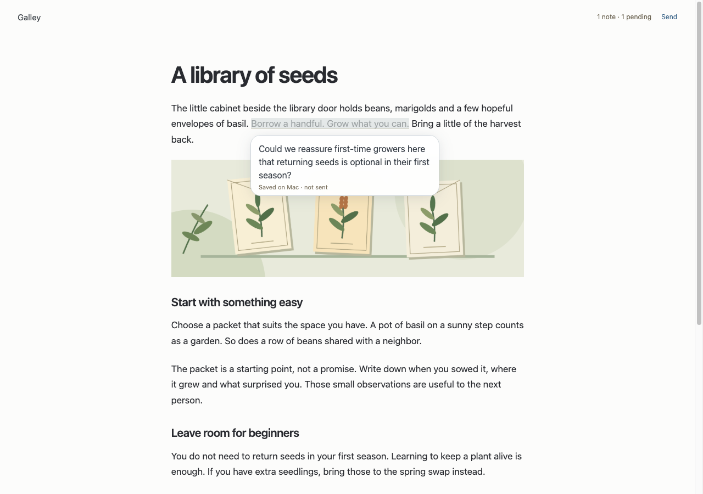

<p align="center"></p>

# Galley

**Read the draft. Highlight a passage. Tell the editing agent what to change.**

Galley is a private, self-hosted rendered review page for drafts you’re writing with agents. Open it on your phone or desktop, select text across the continuous document, and leave a contextual comment. Pending notes are shared through your Mac. One **Send** at the top delivers them together to the same direct editing session—not through a lead or a second rewriting agent.

As that session revises the file, the page refreshes automatically, with reading-position restoration and retained notes. Active selection and composition defer prose replacement; original quotes survive changes even when a highlight can no longer be placed safely.

<p></p>



Actual responsive-browser captures at 390 × 844 and 1280 × 900, using original synthetic text and a local illustration. The note was selected and saved through the real review UI; it has not been sent to an editor. These are not physical-device or Safari captures. [Capture details](docs/images/README.md).

## Install from source

macOS-oriented; requires Node.js **22.12.0 or newer** and npm, matching the package and locked dependency minimum. Native operation uses POSIX ownership/modes, Unix sockets and `/bin/ps`; Windows is not supported. Other Unix platforms are not verified.

```sh
git clone https://github.com/batteryshark/galley.git
cd galley
npm ci --ignore-scripts --no-fund
npm test
```

There is no build step or npm publication; `private: true` is intentional. Tests use temporary synthetic drafts and skill fixtures, not your enrolled document. They do not establish compatibility with your actual editing runtime or real phone gestures.

## Try rendered review, disconnected

Create a small Markdown file in a project you own. Save a private `binding.json` outside the public checkout, replacing every illustrative path below with an existing canonical absolute path (no symlinks):

```json
{
  "draft": "/ABSOLUTE/PATH/TO/draft-project/draft.md",
  "sessionDirectory": "/ABSOLUTE/PATH/TO/draft-project",
  "assetRoots": [],
  "sessionId": "not_connected",
  "upstreamIdentity": "disconnected-example"
}
```

From the cloned Galley directory, enroll once, issue a private link, then serve:

```sh
node bin/galley.mjs enroll /ABSOLUTE/PATH/TO/private/binding.json
node bin/galley.mjs link
npm start
```

Open the URL printed by `link` in your own browser. Default: `http://127.0.0.1:4177/galley/`. Treat its fragment as a bearer secret: never commit, log, screenshot or publish it. The illustrative binding identifiers above are inert, not a real editing session.

Select text, tap the contextual field (or start typing on desktop), and finish with Enter, Escape or tap-away; Shift+Enter adds a line. Acknowledged notes are saved on the Mac and visible on your other device. Unacknowledged text exists only in that tab’s memory: copy it before closing or reloading. **Disconnected mode does not dispatch feedback or make edits.** Send reports the unavailable editor and leaves notes pending. Editing the Markdown file yourself demonstrates automatic refresh.

`assetRoots` can list up to 16 explicit existing image directories. Optional `siteAssetRoot` must be one of them and maps `/assets/` references. Never enroll a real document merely to try screenshots.

## Connect the actual editor

Follow the [native setup guide](docs/native-setup.md): supply four caller-owned skill files, generate inert artifacts, separately install the writer profile and project-local plugin, start one compatible OpenCode runtime, then run Galley’s native **startup** connector. Later restarts use **attach** to the confirmed writer. OpenChamber can display and converse with that same runtime session; it is not a separate HTTP relay.

The four skills are **not bundled and are not assumed publicly available**. `binding.skillPaths` must contain four canonical absolute file paths; the fourth must contain Humanizer `version: 3.1.0` metadata. Supporting trees require explicit validated `skillReferenceDirectories`; none are implicitly granted. Preparing a profile does not install it, start a session, or grant general project editing.

This integration targets a specific native plugin-context API contract, not a generic stable SDK or arbitrary OpenCode/OpenChamber version. **“Admitted to editor” is not “edits completed.”** Confirm results in the direct editing session and revised draft.

## Read privately from your phone

Use a private Tailscale Serve HTTPS mount, not Funnel. Both devices need tailnet access; the Mac must remain awake with Galley, Tailscale and (for editing) its native runtime available. The guide includes the [route pattern and exact-origin setup](docs/native-setup.md#private-tailscale-route). The loopback listener remains `127.0.0.1:4177`; external paths remain `/galley/`.

`GALLEY_ORIGIN` must be the exact browser origin, including any nondefault port, **without** a path or trailing slash. For example, `https://review.example.invalid:9443` is a reserved illustration, not a working host. Set the same value for link issuance and serving. Nonloopback origins require HTTPS; Host/Origin mismatches fail closed.

## Link lifecycle and recovery

- CLI links expire after **one hour**. Renew by issuing a new `link`; this does not revoke older unexpired links. `revoke` invalidates all stored review links. The lower-level store API allows up to 24 hours, but the CLI has no TTL flag.
- The serving process holds an exclusive `.galley` store lock. Gracefully stop it before running `link` or `revoke` from the same working directory, then restart disconnected `serve` or native **attach**, not native startup again. Keep the same store and native journals. There is no link-management UI in the current page.
- Locks fail closed, including stale store locks. Confirm the old process is gone and reconcile state before any manual recovery; never delete a lock or journal to force a retry.
- Uncertain startup or Send is a durable **no-replay fence**. Check the exact editor’s history and draft manually. Restarting, changing a request ID or generating another writer is not a safe retry. There is no automatic reconciliation/clear-fence CLI.

Fleet or another supervisor is optional operator infrastructure: nothing here installs, registers or starts Fleet. Configure at most one Galley store owner, use attach after confirmed startup, and preserve private state across restarts.

## Boundaries

- One bound Markdown document per store. Private review for a trusted operator, not multi-user collaboration SaaS, account management, or protection from hostile same-user processes.
- Everyone with a valid link and network access shares review authority and pending notes; there are no per-person roles. Browser access does not expose a general agent API.
- Markdown is sanitized to inert document elements. Scripts, arbitrary HTML attributes, external navigation and remote images are stripped. Local PNG/JPEG/GIF/WebP images must be inside registered roots; no SVG. Draft limit: 1 MiB; image limit: 5 MiB each, 64 image IDs and a 20 MiB presentation-read budget. Unavailable images fail visibly.
- Text selections span DOM nodes, up to 12,000 UTF-16 code units; comments up to 8,000. Changed/ambiguous quotes require review and explicit Send confirmation; original quotes remain in history. This is not a visual image-annotation tool or a guarantee of lossless Markdown-site rendering.
- Responsive browser screenshots do not verify physical iPhone selection handles, Safari toolbars or keyboard overlap. Device acceptance is separate.
- Public source does **not** make your documents, links, runtime bindings, skills or capabilities public. Keep all operator inputs, generated profiles and state private and outside any published tree.

## Licence and credits

[MIT](LICENSE), copyright © 2026 batteryshark. [Third-party notices](THIRD_PARTY_NOTICES.md) retain dependency terms.

The [Workstack-style comic logo](release-assets/logo/README.md) was AI-generated through OpenAI’s native GPT image route, documented as `gpt-image-2`; the runtime image-model ID was not independently verified.
